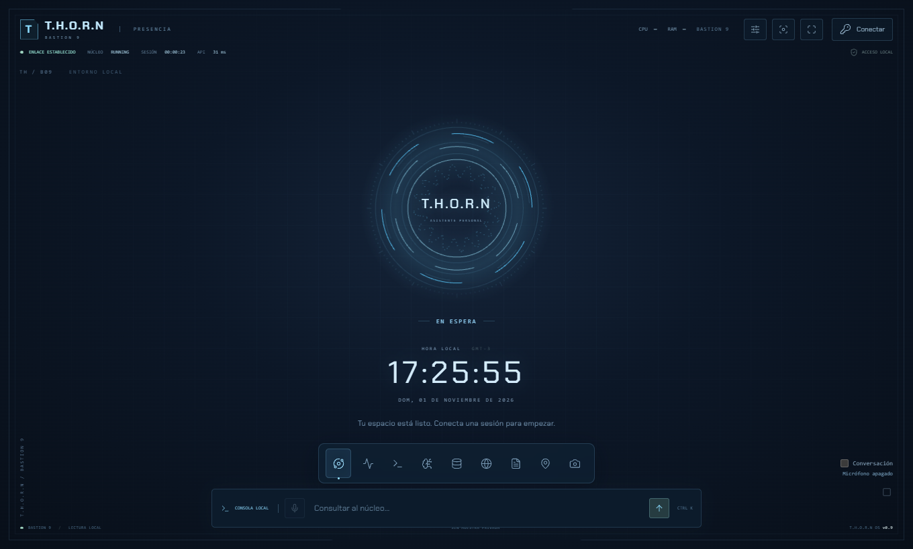

# T.H.O.R.N — Bastion 9

Este es mi proyecto para construir mi propio asistente para la PC. La idea nació
de esas ganas de tener algo estilo J.A.R.V.I.S. o E.V., que pudiera conversar
conmigo, mostrar lo que pasa en el equipo y ayudarme con tareas del día a día.

Lo estoy armando de a poco en un ASUS TUF F15. También es una forma de aprender
sobre backend, programación asíncrona, interfaces y seguridad. Voy probando,
corrigiendo errores y dejando notas para entender lo que hice cuando vuelva
al código. Todavía está en desarrollo y hay bastante por mejorar.

**T.H.O.R.N es el nombre del asistente. Bastion 9 es la actualización actual.**



*Captura real del HUD en modo Presencia, sin conectar la sesión de datos privados.*

## Qué hace por ahora

- Conversa usando **Ollama y un perfil local de Qwen2.5 1.5B**. Conserva un
  contexto corto y recupera conversaciones anteriores desde un archivo cifrado,
  incluso después de desconectar o reiniciar el programa.
- Tiene voz local con **Piper** y reconocimiento de voz con **Vosk**. La
  conversación funciona por turnos: cierra el micrófono mientras responde.
  Puede esperar a que digas **«Thorn»** y permitir seguimientos durante 30 segundos.
- Muestra hora, CPU, RAM, disco, procesos y actividad con datos del equipo.
  Si falta una lectura, lo indica.
- Guarda notas, preferencias y auditoría en MySQL. Incluye cifrado para datos
  y secretos, respaldos recuperables y herramientas para firmar distribuciones.
- Lee texto de PDF y permite ver el documento con páginas y zoom.
  Si es un escaneo, **Leer página escaneada** reconoce su texto con OCR local.
- Busca información y lugares con fuentes. Los mapas usan OpenStreetMap y
  requieren autorización para conectarse a Internet.
- Incluye cámara local y gestos experimentales para mover elementos del HUD.
- Propone algunas acciones de Windows dentro de un catálogo limitado, con
  confirmación y auditoría antes de ejecutarlas.

El HUD tiene modos **Presencia** y **Trabajo**, un menú radial y ventanas que
se pueden mover, ampliar, minimizar y cerrar. El núcleo reacciona al audio
que se está reproduciendo. Pulsa el núcleo para abrir el menú o **F2** para
cambiar de modo. Los controles están en la [guía del HUD](docs/HUD_BASTION_9.md).

## La parte de la IA

El perfil `thorn:bastion9` reutiliza un modelo preentrenado de Qwen, ejecutado
localmente por Ollama. La personalidad, la interfaz y las herramientas se
conectan desde T.H.O.R.N. Cambiar el nombre o el prompt de un modelo no equivale
a entrenarlo desde cero; esto también forma parte de lo que estoy aprendiendo.

Mi intención es que las conversaciones, el dictado y la voz funcionen en la PC
sin depender de créditos por consulta. El modo predeterminado es local. Hay
integraciones opcionales con ElevenLabs y Brave, que quedan bloqueadas mientras
`THORN_LOCAL_AI_ONLY=1`. Los modelos sí necesitan descargarse al preparar el equipo.

La [guía de autonomía local](docs/AUTONOMIA_LOCAL.md) explica la instalación y
la procedencia de cada motor.

## Si quieres probarlo

Estos pasos están pensados para Windows y PowerShell. Uso **Python 3.12** y
**Node.js 24**; los archivos de dependencias incluyen versiones y hashes.
Para conversar hace falta instalar Ollama y el modelo. Para guardar datos hace
falta MySQL. Puedes empezar viendo el HUD sin base de datos ni modelos.

```powershell
git clone https://github.com/jeraldo114/Proyecto_T.H.O.R.N.git Proyecto_Thorn
cd Proyecto_Thorn
py -3.12 -m venv .venv
.\.venv\Scripts\python.exe -m pip install --require-hashes -r requirements.txt

# Crear la configuración solo si todavía no existe.
if (-not (Test-Path -LiteralPath .env)) {
    Copy-Item -LiteralPath .env.example -Destination .env
}

cd frontend
npm ci
npm run build
cd ..

.\.venv\Scripts\python.exe serve.py --sin-db --port 8000
```

Abre [el HUD local](http://127.0.0.1:8000/). La pantalla puede abrirse sin sesión;
los datos privados y las herramientas necesitan conectarse. Desde otra terminal
en la carpeta del proyecto puedes obtener una sesión temporal:

```powershell
.\.venv\Scripts\python.exe tools/session_access.py --port 8000 --mostrar-token
```

Pega el token en **Conectar** y mantenlo privado. El token vive en memoria,
caduca y se renueva durante el uso. El lanzador de escritorio conecta su sesión
automáticamente. Si necesitas detener el servidor, usa **Ctrl+C**.

### Para usar MySQL y los motores locales

Crea la base `db_thorn` en MySQL y completa los campos `MYSQL_*` de tu `.env`:

```sql
CREATE DATABASE IF NOT EXISTS db_thorn CHARACTER SET utf8mb4;
```

Después inicia `serve.py` sin `--sin-db`. Los servicios con persistencia preparan
sus tablas auxiliares al arrancar. Conviene usar un usuario MySQL propio para
T.H.O.R.N; el `root` de la plantilla es una configuración inicial de desarrollo.

La voz, el micrófono y los gestos tienen sus dependencias y modelos separados.
Dejé los pasos en [Autonomía local](docs/AUTONOMIA_LOCAL.md),
[Micrófono](docs/MICROFONO_LOCAL.md) y [Bastion 9](docs/BASTION_9.md).
El cifrado también se configura en cada instalación: sigue la
[guía de cifrado y respaldos](docs/CIFRADO_Y_RESPALDOS.md).

### Ventana de escritorio

```powershell
.\.venv\Scripts\python.exe -m pip install --require-hashes -r requirements-desktop.txt
.\.venv\Scripts\python.exe desktop.py
```

La ventana usa WebView2 y tiene bandeja del sistema. También hay herramientas
para compilar un ejecutable y preparar un paquete firmado. El repositorio
comparte el código y las plantillas; los datos, las claves, los modelos y los
binarios generados se mantienen fuera de Git.

## Lo que sigo afinando

Sigo afinando la fluidez y el consumo. El núcleo reduce sus fotogramas cuando
está en reposo y el OCR carga un solo worker cuando hace falta. Los gestos
incluyen suavizado y una pinza sostenida para evitar movimientos accidentales;
todavía dependen de la luz, la cámara y la posición de la mano.

El OCR reconoce texto impreso de la página elegida. Puede equivocarse y no
convierte al modelo de texto en un experto que interpreta automáticamente
circuitos, diagramas o imágenes. La activación por «Thorn» usa la transcripción
local; necesita la sesión y el permiso del micrófono. No escucha con la ventana
oculta ni intenta saltarse el primer permiso del navegador.

**Órdenes para el día a día.** «Retoma el tema de cámaras» busca en el
archivo cifrado, muestra la conversación de origen y la incorpora al contexto
de la sesión. «Revisa el equipo» muestra telemetría y alertas locales.
«Investiga sobre …» requiere autorización de Internet. Busca con el proveedor
configurado e intenta leer hasta tres resultados públicos para resumirlos con
fuentes. Wikipedia cubre temas enciclopédicos. La búsqueda web general usa el
proveedor Brave ya previsto y requiere su clave y habilitarlo expresamente.

**Conversación progresiva.** El texto aparece durante la generación. Con voz
local automática, una frase completa puede empezar a sonar antes del final.
Usa Escape para cancelar. Si activas la interrupción experimental antes de
iniciar la conversación, di «Thorn, espera». El micrófono usa la cancelación
de eco del navegador y durante la respuesta solo busca esa frase. Su eficacia
depende del dispositivo, el volumen y la acústica. Diagnóstico muestra la
última duración observada de transcripción, generación y síntesis.

**Visión y razonamiento opcionales.** Define en el entorno privado
`THORN_DOCUMENT_VISION_MODEL` con el nombre de un modelo visual instalado en
Ollama. Luego abre un PDF y pulsa **Analizar imagen** en la página elegida.
Puedes marcar **Recortar con el puntero** y arrastrar sobre un circuito para
analizar solo esa región. El HUD muestra la imagen analizada, la página y
el tiempo medido. Las conexiones de un
circuito son estimaciones visuales. Para reservar un modelo mayor para
consultas explícitas, define `THORN_REASONING_MODEL` y escribe
`Analiza a fondo: …`. Ambos modelos opcionales se solicitan con liberación de
memoria al finalizar. El visor y el razonador requieren pesos locales y una
medición en el equipo antes de considerarlos listos para uso habitual.

Las conversaciones completadas ahora se guardan automáticamente **si MySQL y
el cifrado están disponibles**. Al reconectar, se recuperan turnos recientes y
coincidencias de palabras y conceptos de un diccionario local del historial. El archivo conserva el texto completo,
pero el modelo recibe extractos: recordar no equivale a cargar todo en RAM ni
a garantizar que la IA recuerde cada detalle. Puedes buscarlo y borrarlo desde
**Memoria e historial**. También puedes corregir la respuesta de un turno,
buscar un tema y olvidar sus turnos seleccionados, y pausar o reanudar el guardado. El HUD muestra
las fechas y los identificadores de los extractos entregados al modelo. Las notas explícitas siguen separadas y no se guarda audio.
Lo hablado antes de esta mejora no se puede reconstruir si nunca se guardó.

Dejé los controles y límites en [Memoria y fluidez](docs/MEMORIA_Y_FLUIDEZ.md).
Las acciones de Windows siguen necesitando su confirmación independiente.

## Para no perderme entre las carpetas

| Carpeta | Qué estoy poniendo ahí |
| --- | --- |
| `core/` | Núcleo asíncrono, sensores, IA, voz, sesiones y persistencia. |
| `api/` y `thorn_web/` | API local, permisos y arranque del servidor Django ASGI. |
| `frontend/` | HUD, ventanas, audio, cámara y gestos. |
| `tools/` | Instaladores, acceso local, respaldos, compilación y firma. |
| `tests/` | Pruebas del backend; las del HUD están en `frontend/tests/`. |
| `docs/` | Notas, decisiones y pasos de instalación. |

Si usas VS Code, abre `THORN.code-workspace`. El
[mapa del proyecto](docs/MAPA_DEL_PROYECTO.md) explica la organización.
En el código vas a encontrar comentarios con **NOTA DEL OPERADOR**: son las
cosas que quiero recordar al seguir metiendo mano.

## Cómo compruebo los cambios

```powershell
.\.venv\Scripts\python.exe -W error::ResourceWarning -m unittest discover -s tests -v
.\.venv\Scripts\python.exe manage.py check
.\.venv\Scripts\python.exe tools/check_repository.py --working-tree
cd frontend
npm test
npm run build
```

Bastion 9 cuenta con **221 pruebas de backend y 52 de módulos del frontend**,
además de pruebas de los flujos del HUD. Pasarlas ayuda a encontrar errores;
todavía queda probar el uso cotidiano en distintos equipos.

Para profundizar están las [notas del proyecto](docs/NOTAS_DEL_PROYECTO.md),
el [método para el coordinador local](docs/METODO_COORDINADOR_LOCAL.md),
la [guía de seguridad](SECURITY.md) y los pasos de
[publicación en GitHub](docs/PUBLICACION_GITHUB.md).

Si encuentras algo que no funciona o tienes una idea, puedes abrir un issue.
Me sirve conocer qué probaste y qué pasó. Si se trata de una vulnerabilidad o
incluye información privada, revisa primero [SECURITY.md](SECURITY.md).
