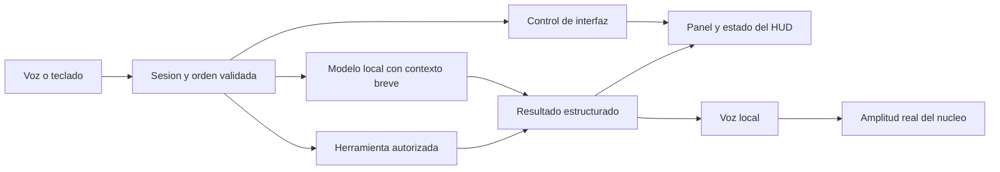

# T.H.O.R.N — referencia visual y funcional de Huw Prosser

Analisis de los cinco videos indicados por el operador. Revision: 31 de octubre
de 2026. Se examinaron cuadros distribuidos por cada clip y transcripciones
automaticas locales de los cuatro que contienen dialogo. La transcripcion sirve
de apoyo: no se usa como una cita literal garantizada.

Este documento conserva la propuesta original del 31 de octubre. El estado
implementado de sus funciones se documenta en [Bastion 9](BASTION_9.md);
la evolucion visual esta descrita en [HUD Bastion 9](HUD_BASTION_9.md).
Las tablas siguientes conservan el estado observado al analizar los videos.
Los archivos audiovisuales son privados al checkout,
estan en `.artifacts/` y quedan fuera de Git.

## Que muestra cada referencia

| Video | Observaciones verificadas | Aplicacion a T.H.O.R.N |
| --- | --- | --- |
| [DZhpapYIOhH](https://www.instagram.com/p/DZhpapYIOhH/) · 19 s | En un portatil se alternan un nucleo circular, un menu radial con sectores y un control horizontal. Una mano interviene en la demostracion. El autor describe la interaccion como incomoda. | Usar un menu radial para accesos rapidos con raton/teclado. Los gestos deben ser opcionales y demostrar utilidad antes de sustituir otros controles. |
| [DYcGx6Do4rv](https://www.instagram.com/p/DYcGx6Do4rv/) · 35 s | Una peticion abre la camara. El autor explica el cursor y arrastre gestuales, mueve el nucleo y pide noticias; aparecen varios widgets con contenido visual. Reconoce lentitud y fallos del experimento. | Separar contenido en paneles que puedan moverse. La voz solicita la herramienta; el panel muestra el resultado y su estado. Camara y gestos requieren su propia activacion. |
| [DYEhKXXIW5Q](https://www.instagram.com/p/DYEhKXXIW5Q/) · 26 s | Conversacion breve sobre posibles ampliaciones. Se ven distintas presentaciones del anillo, una cuadricula sutil y un estado de reposo con reloj. La respuesta alude a intereses del propietario. | Dar espacio al nucleo y al reloj. Conectar la personalidad con preferencias expresamente guardadas, diferenciandolas del contexto de la conversacion actual. |
| [DX6PkOBIwBc](https://www.instagram.com/p/DX6PkOBIwBc/) · 46 s | La conversacion cambia entre mapas de ciudades y despues solicita un esquema de una placa. El documento aparece en un visor sobre el mapa. El nucleo permanece pequeno en una esquina. | Mantener al asistente visible mientras el resultado ocupa el espacio principal. Un visor documental es una capacidad distinta de buscar o resumir texto web. |
| [DXjFNwmCE40](https://www.instagram.com/p/DXjFNwmCE40/) · 30 s | Se pasa de reposo con reloj a una vista de camara. Hay bienvenida, hora, un breve resumen y una pregunta posterior que retoma el modelo mencionado antes. Tambien se pide detener la musica. | Crear un resumen de inicio con datos verificados, conservar referencias entre turnos y separar las ordenes de control de una consulta al modelo. |

Lo mostrado en un video no permite medir con rigor la latencia, comprobar que
no hubo cortes, verificar el origen de todos los datos ni reproducir los modelos
privados del autor. La noticia mencionada en el ultimo clip se trata como parte
de la demostracion, no como una noticia validada por este analisis.

## La direccion visual

La pantalla funciona como un escritorio del asistente: fondo oscuro azulado,
cuadricula discreta, bordes finos, nucleo circular luminoso y bastante espacio
libre. El nucleo cede protagonismo cuando hay contenido que leer. Esa relacion
entre reposo y trabajo es mas util como referencia que copiar un fotograma.

Para T.H.O.R.N, mantener la identidad propia y sus acentos cian. El cristal
actual puede conservarse como emblema propio dentro de anillos mas legibles;
no necesitamos reutilizar logos, grabaciones ni recursos del otro proyecto.

- **Presencia:** nucleo, reloj real, estado del microfono y una consola discreta.
  Evoluciona el modo enfoque existente; la telemetria queda a un acceso.
- **Trabajo:** el resultado ocupa el centro; el nucleo pasa a una esquina sin
  ocultar escucha, sintesis o errores. Los paneles se pueden minimizar y cerrar.
- **Diagnostico:** conserva CPU, RAM, disco, actividad y bus con sus fuentes
  actuales. Los datos vencidos siguen marcandose como no vigentes.
- **Accesos rapidos:** menu radial o dock para sistema, historial, busqueda,
  conversacion y preferencias, con equivalentes accesibles por teclado.

El pulso durante la voz debe conservar el RMS del audio reproducido que ya usa
T.H.O.R.N. Una animacion ornamental no debe presentarse como actividad neuronal
ni como evidencia de que el modelo esta pensando.

## Lo que tenemos y lo que falta

| Area | Base actual comprobada en el codigo | Siguiente cambio |
| --- | --- | --- |
| Nucleo | Three.js, anillos y cristal; amplitud de voz real; limite de 30 FPS. | Unificar los estados de conversacion con el aspecto del nucleo y permitir posicion central/esquina. |
| Enfoque | El boton de enfoque oculta telemetria y actividad. | Convertirlo en un modo Presencia completo, con reloj y controles esenciales. |
| Resultados | Vistas por seccion y una salida principal de consola. | Introducir paneles por resultado, con titulo, origen, estado y controles. |
| Conversacion | VAD, dictado Vosk, Ollama y salida Piper, por turnos. | Contexto breve aislado por sesion para preguntas de seguimiento. |
| Memoria | Notas explicitas e historial persistente cifrado. | Recuperar preferencias pertinentes sin guardar todas las conversaciones por defecto. |
| Internet | Busqueda, lectura y resumen con fuentes; consentimiento por sesion. | Presentar esas fuentes en paneles. PDF, mapas y otros formatos necesitan adaptadores propios. |
| Acciones Windows | Catalogo cerrado, confirmacion y auditoria. | Ampliar destinos concretos cuando sean necesarios, conservando ese recorrido. |
| Camara y gestos | No forman parte del HUD actual. | Modulos opcionales, con permiso, indicador visible y cierre efectivo del dispositivo. |

La diferencia de contexto es concreta: `core/local_llm.py` envia actualmente el
prompt del sistema y la pregunta de ese turno a Ollama. Conservar el modelo
cargado mediante `keep_alive` no conserva por si solo una conversacion.
Las notas persistentes tampoco equivalen a un historial conversacional activo.

## Orden de implementacion

1. **HUD y estados.** Evolucionar `frontend/src/core-scene.js`, `hud.js` y
   `hud.css` para Presencia/Trabajo y un nucleo que represente los estados reales.
   Mantener el reloj local, las mediciones existentes y el movimiento reducido.
2. **Paneles de resultados.** Empezar con diagnostico, respuestas, notas y fuentes
   web que la API ya entrega. Un gestor separado del renderizador del nucleo
   administra apertura, enfoque, minimizado y cierre. El contenido remoto se
   presenta como texto seguro y enlaces validados, no como HTML ejecutable.
3. **Continuidad.** Agregar un contexto acotado en RAM por identidad de sesion,
   con caducidad, limpieza al desconectar y presupuesto compatible con los
   2048 tokens de contexto actuales. Una sesion no lee los turnos de otra.
4. **Ordenes de interfaz y resumen inicial.** Resolver solicitudes como mostrar
   sistema, abrir historial o detener una respuesta sin esperar a Ollama. El
   resumen inicial usa hora, alertas y datos disponibles; noticias externas solo
   si existe autorizacion y una consulta con fuentes recientes.
5. **Vision y documentos.** Incorporar despues un visor PDF y camara local.
   Gestos, mapas y controles multimedia se evaluan como capacidades separadas.
   Evitar que el efecto visual obligue a encender la camara.

Esta es una arquitectura propuesta. No implica que todas las llamadas actuales
de la API se esten distribuyendo por el bus de eventos.

## Como comprobaremos la adaptacion

- El nucleo distingue desconexion, reposo, escucha, transcripcion, consulta,
  reproduccion y error a partir de los servicios y dispositivos reales.
- Abrir un resultado deja espacio para leerlo; cerrar o minimizar su panel no
  destruye la sesion ni deja la interfaz atascada.
- La informacion conserva fuente, fecha y estado. No se rellenan huecos con
  cifras, mapas o noticias inventadas.
- Una pregunta de seguimiento dispone del contexto autorizado de esa sesion.
  El contexto tiene limites y no revela conversaciones de otra sesion.
- Las propuestas del modelo siguen necesitando el controlador y la confirmacion
  correspondientes antes de producir efectos sobre Windows.
- El HUD mantiene movimiento reducido y verificaciones de rendimiento en el F15.
  El I/O y la inferencia permanecen fuera del hilo de interfaz o del event loop
  cuando las bibliotecas utilizadas son sincronicas.

**NOTA DEL OPERADOR:** queremos que T.H.O.R.N se vea presente y trabaje contigo.
Cada brillo debe acompanar un estado y cada resultado debe explicar de donde
salio. La personalidad puede tener humor seco; los datos no pueden improvisar.
